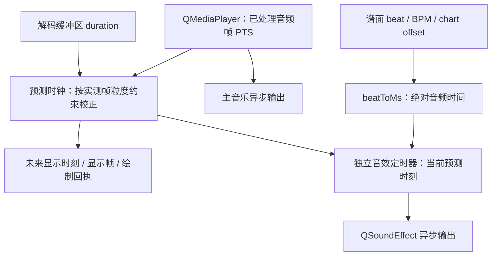

# Note 音时序排查（2026-10-17）

## 结论与修复边界

这不是一个可以用固定 offset 修正的单一偏移。已确认的问题分别发生在输入、
时钟观测、音效调度三个层级；此外，主音乐与 QSoundEffect 仍走不同的输出队列。

| 层级 | 相关提交 | 已确认的问题 | 本次处理 |
| --- | --- | --- | --- |
| 本地音频输入 | `33196e8` | 对本地文件启用 LowLatencyStreaming；Qt/FFmpeg 探测时丢弃已读取的首段数据 | 恢复普通文件播放意图 |
| 显示与音效调度 | `33196e8`、`b111997` | Note 音依赖显示帧；后者进一步让下一帧等待画布绘制回执 | 独立的精确定时器提交音效，不等待 paint acknowledgement |
| 音频时钟观测 | `b111997`、`2a0dd9a` | 将音频帧 PTS 当成瞬时连续时钟，平滑追赶或硬重同步会把帧粒度误当漂移 | 按实际解码帧时长建立观测不确定范围，仅校正范围外的误差 |
| 自动定时验证 | `645fd70`、`79724ba` | 测试给已含 offset 的绝对音频时间再次加 offset；后续注释将测试失败误标为生产回归 | 改用真实播放缓存验证，保留 `645fd70` 的生产换算 |

本次没有更改谱面 offset、全局音频 offset、默认音效素材，也没有加入输出延迟
补偿常量。移除了原有的 8 ms 提前量。

软件提交误差降低不等同于硬件发声已达到同等精度。QTimer 仍运行在 GUI 线程，
真正的 UI 线程阻塞仍会延迟提交；独立 QSoundEffect 与主音乐输出队列之间的差异
也仍存在。不能将本次结果表述为“所有设备上采样级对齐”。

## 时间链路与单位

`MathUtils::buildBpmTimeCache` 从 `-offset` 开始累积；因此 `beatToMs` 的结果已经是
音频文件时间，逆变换 `msToBeat` 内部相应加上 offset。ChartCanvas 的 Note 缓存
直接使用这一结果。`AudioPlayer::adjustedPosition` 中的用户全局校准则是另一个
概念；不能把谱面 offset 再加到播放缓存结果中。

墙钟时间与媒体时间按播放倍率换算。例如 85.333 ms 的媒体帧在 0.1× 下覆盖
853.333 ms 墙钟时间。音频位置数值与声卡已经播放的采样位置也不是同一观测量。

## 证据一：LowLatencyStreaming 会丢失本地文件首段

使用临时生成的 48 kHz / 双声道 / PCM16 / 40 秒 WAV，通过当前编辑器的
AudioPlayer、PlaybackController、ChartCanvas 和 NoteSoundPlayer 全链路运行。

| 配置 | 首个解码缓冲区 startTime | 首次音频位置推进 |
| --- | ---: | ---: |
| 原 LowLatencyStreaming | 4266.667 ms | 约 4301 ms 墙钟 |
| 仅切换普通 Playback | 0 ms | 约 51 ms 墙钟 |

证据文件：`artifacts/notesound_ab_streaming.json`、`artifacts/notesound_ab_file.json`。
首个解码时间戳直接说明文件前段未被交给播放链路，不是听感推测。
这只是指定 WAV/Qt 版本的复现值，不能推断所有格式都恰好丢失 4266.667 ms。

Qt 6.10.2 的 [MediaDataHolder 实现](https://raw.githubusercontent.com/qt/qtmultimedia/v6.10.2/src/plugins/multimedia/ffmpeg/playbackengine/qffmpegmediadataholder.cpp)
在流式意图下设置 `fflags=nobuffer` 与 `flush_packets=1`，之后调用
`avformat_find_stream_info`。此行为与本地文件编辑所需的完整时间线冲突。
从非零位置主动 seek 时会重新定位输入，因此这一问题可能表现为“从头播放与
中途播放不同”，而不是每次都出现同一个偏移。

## 证据二：音效被显示绘制回执限速

合成 Note 放在 `137 + 437*n` ms，刻意避免与 60 Hz 显示帧或 100 ms 周期整齐重合。
只延后绘制确认，不阻塞 GUI 线程，可以单独验证调度链路的依赖。

| 配置 | 提交相对预测时钟的中位误差 | 最大误差 |
| --- | ---: | ---: |
| 旧调度 + 8 ms 提前量，正常绘制 | 1.462 ms | 8.433 ms |
| 旧调度，绘制确认延后 90 ms | 51.960 ms | 90.188 ms |
| 独立定时器、无提前量，正常绘制（第一轮） | 0.797 ms | 1.299 ms |
| 独立定时器、绘制确认延后 90 ms（第一轮） | 0.840 ms | 1.405 ms |

旧调度的最小误差约 -8 ms，正是人为提前量的表现；最大/最小值会随帧相位变化，
不能仅凭平均值判断同步。原始数据分别见 `notesound_ab_file.json`、
`notesound_ab_paint90.json`、`notesound_fixed_1x.json`、`notesound_fixed_paint90.json`。
这些数值都只是提交时间，不是硬件发声延迟。

新的 `seeked` 信号同时重置扫描起点。否则播放中向前跳转时，旧扫描区间可能被
当成“本帧到期”的 Note，集中触发已跳过的音效。

## 补充复现：密集 Note 音粘连

密集问题与固定偏移不同，也不完全由绘制频率造成。通过正常定时触发和有意阻塞
GUI 线程的对照实验，分离出以下机制。

### 六声部抢占与素材重叠

当前 NoteSoundPlayer 只有六个 QSoundEffect；没有空闲声部时会对最早的声部执行
`stop()` 再 `play()`。默认 `kickwav.wav` 时长 278.844 ms，约 99% 能量持续到
184.218 ms，40 ms 之后仍有约 76.645% 的剩余能量。它不是开头短促、后段全静音的
素材；密集播放本来就会将尚未结束的声音相叠加。

在只静音诊断进程、保留真实播放状态与定时的实验中：

| 素材 / Note 间隔 | 提交次数 | 强制抢占次数 | 同一毫秒最大提交数 |
| --- | ---: | ---: | ---: |
| 默认 kick / 100 ms | 24 | 0 | 1 |
| 默认 kick / 40 ms | 60 | 54 | 1 |
| 默认 kick / 20 ms | 118 | 112 | 1 |
| 100 ms 测试音 / 20 ms | 168 | 0 | 1 |

这说明正常定时器没有把这些密集音符压在一起，但默认长素材会使池几乎一直满载。
六声部的名义容量约为 `6 / 0.278844 = 21.5` 次/秒；实际还受后端状态切换影响。
证据为 `artifacts/notesound_dense_kick_*.json`、`notesound_dense_short_20ms.json`。

真实 Pioneer3 谱面在 Release / 10× / 3 秒实测中提交 280 次音效、抢占 274 次，
同样几乎每次都在六声部满载后重启；这不只出现在合成极限样本中。该轮提交抖动
p90 2.07 ms、最大 4.58 ms，显示性能判定通过。证据为
`artifacts/notesound_release_dense_final10x.json` 和同名日志。

对原素材做不截尾的线性叠加模拟时，40 ms / 20 ms 间隔的峰值分别达到满幅的
1.715 / 2.042 倍，超满幅采样比例约 14.51% / 49.67%。这是源素材的数学叠加
结果，不是已测得声卡削波；实际增益和系统压限会改变结果。但它说明密集长尾会
同时带来动态范围问题，单纯增加 QSoundEffect 数量不能保证听感恢复清晰。

### UI 阻塞恢复后的音效堆叠

100 ms 测试音每 20 ms 正常播放时没有抢占。只额外阻塞 GUI 150 ms 后，恢复时
8 个已经过期的音效在约 0.14 ms 内被提交，整段出现 12 次声部抢占：
`artifacts/notesound_dense_stall_20ms.json`。

本次将每次唤醒时的积压音效合并为最新的一个提示，避免恢复时把过去的攻击音
同时叠上去。按时到达的独立唤醒仍分别发声，谱面中的 Note 完全不变。
`note_sound.coalesced_overdue` 记录被合并的过期提示数量。

同参数修复后，单毫秒最大提交数从 8 降为 1，抢占次数从 12 降为 0；无阻塞时
仍有 168 次正常提交、0 次抢占。证据为 `notesound_dense_stall_fixed.json` 与
`notesound_dense_normal_fixed.json`。新增自动回归也验证恢复时只提交一个提示。

**剩余限制**：默认长素材本身的尾音重叠、六声部池的持续满载仍存在。本次没有
擅自截断素材、调整音量或通过加大固定声部数掩盖它们。完整解决应使用持久的
PCM 混音输出与明确的重叠/动态范围策略，并同时评估主音乐和音效的输出时钟。

## 证据三：慢速下把音频帧粒度误当时钟漂移

Qt 6.10.2 的 [PlaybackEngine::currentPosition](https://raw.githubusercontent.com/qt/qtmultimedia/v6.10.2/src/plugins/multimedia/ffmpeg/qffmpegplaybackengine.cpp)
读取 renderer 的最后处理位置；[Renderer::doNextStep](https://raw.githubusercontent.com/qt/qtmultimedia/v6.10.2/src/plugins/multimedia/ffmpeg/playbackengine/qffmpegrenderer.cpp)
在一帧处理完成时将该位置更新为该帧起始 PTS。这不是直接读取声卡连续时钟。

在 0.1× WAV 实验中：

- 解码缓冲区 PTS 0 / 85.333 / 170.666 ms，分别在墙钟约 6 / 836 / 1690 ms 交给输出。
- 首个 `positionChanged(85)` 直到墙钟约 1652 ms 才出现，不能解释为这之前都未播放。
- 随后墙钟约 2502 ms 的观测为 170 ms，而预测约为 250 ms。旧逻辑把约 80 ms
  媒体误差当作漂移，触发硬重同步；在 0.1× 下相当于约 800 ms 的墙钟回跳。
- 574 ms 的第二个 Note 因此在墙钟约 6538 ms 才提交，而不发生该回跳时应在
  墙钟约 5740 ms 附近。见 `artifacts/notesound_fixed_01x_output.json`。

因此，仅“启动时画面不断”和“单次提交抖动约 1 ms”都不能证明音频同步正确。
本次 AudioPlayer 通过 QAudioBufferOutput 记录实际帧时长；校正器将观测视为
一个区间。当预测仍在该区间内时，不因量化误差减速或重同步。超出区间的真实大
偏差仍可触发重同步。这里使用的是输入帧测量结果，不是设备/歌曲补偿 offset。

最终慢速、倍率与实际谱面的复测数据保存为 `artifacts/notesound_final_*.json`；
`tools/perf/note_sound_probe_report.py` 可汇总其中的提交抖动和时钟观测差。

最终版无回环干扰的逐倍率复测（同一 Qt/设备）：

| 工况 | 提交次数 | 最大提交误差（墙钟） |
| --- | ---: | ---: |
| 0.1× | 2 | 1.075 ms |
| 0.25× | 3 | 1.100 ms |
| 1× | 10 | 0.808 ms |
| 2× | 14 | 1.432 ms |
| 10× | 80 | 1.280 ms |
| 1×，绘制确认延后 90 ms | 10 | 1.223 ms |
| Pioneer3，28000 ms 起播 | 8 | 1.140 ms |

0.1× 的第二个 Note 最终在墙钟 5742.510 ms 提交，恢复到预期 5740 ms 附近，
而不是未修正观测粒度时的 6537.547 ms。2.510 ms 包含播放命令建立锚点之前的
调用耗时；相对预测时钟的本次提交误差为 1.075 ms。小样本结果不代表长期最坏值。

## 自动定时测试的 137 ms 假回归

重新构建旧测试后，`core_audio_to_chart_accuracy` 报告 accelerando 137.015546 ms、
decelerando 137.417554 ms，确实复现了此前记录的失败。

但旧断言使用 `beatToMs(..., offset) + offset`，与 ChartCanvas 的实际消费方式
不一致。改用 `buildBpmTimeCache(..., offset)` 并直接 `beatToMs` 后，误差分别为
0.822821 ms / 0.417554 ms，覆盖 offset -87 / 0 / 137、原始与裁剪平移时间线。

生产端 `645fd70` 的换算未被回退，只删除误导的 TODO 并修正测试单位。
将原来的额外 offset 加减配对恢复，会重新引入真实播放时间的重复换算。

## 本机实际谱面与不修改验证

只读检查了本机安装实例：

`C:/Users/mystia/AppData/Local/CatchEditor/Malody Catch Chart Editor/beatmap/Pioneer3/1789316799.mc`

该谱面 offset=87，BPM=180，首个普通 Note 为 beat 87，对应音频时间 28913 ms。
从 28000 ms 开始运行真实谱面和 OGG，使用与生产画布相同的时间缓存。
第一轮独立定时器复测 8 个唯一 Note 时刻，提交最大误差 1.528 ms。
原始谱面排查前后的 SHA-256 均为：

`503AFD74C6FFC53A09CD0AC900E1EDB3FD907B7037FA967632F10296BA14841B`

性能基准使用复制到 `artifacts/notesound_pioneer_fixture` 的谱面和资源，避免
应用的工作副本或统计 sidecar 影响原文件。诊断工具的真实谱面分支只读 JSON
及音乐，不调用会保存谱面或重命名资源的导入路径。

## 实际输出的限制与后续方向

本机 Qt 6.10.2 / Realtek USB2.0 输出的合成音回环中，冷启动首个音效相对提交
约 66–69 ms，后续多数约 20–30 ms。检测窗口为 10 ms，这只能作为独立输出队列
存在变化的线索；系统其他音频和混合音调会干扰检测，不能将该范围自动写成校准值。

最终要验证听到的音乐与 Note 的相位，应在隔离输出中做逐采样对照。要从架构上
保证它们共享同一采样位置，应将音乐与音效混入同一输出缓冲区，并用同一输出
采样计数驱动时间线；这比继续给 QSoundEffect 的 `play()` 加固定提前量可靠。
本次没有将这一较大的音频引擎替换混入修复。

## 自动回归

新增 `audio_playback_timing_tests` 覆盖：

1. 本地 WAV 从头播放的首个解码 PTS 必须为 0。
2. 实测帧粒度内的误差不能触发时钟重同步；区间外的大偏差仍会重同步。
3. 画布未绘制、显示帧停在第一帧时，Note 音仍继续提交；暂停后停止新增提交。
4. 向前跳转不补播跳过的 Note，回到开头后可重新触发。
5. GUI 阻塞恢复时只提交一个最新提示，避免密集过期音效同时堆叠。

播放表现还需结合零预热的 Release 基准及主窗口、快捷键、Analysis Editor 回归
检查。调度单元测试不替代实际设备输出相位验收。

最终验证记录：

- Debug 的音频时序、核心最小测试、快捷键、BPM 测量四组通过。
- Analysis Editor 全组 37 passed / 1 failed / 1 skipped。唯一失败是
  `localTestRecordViewerAndOverviewNavigation` 的概览中点应 seek 到 6000 ms
  断言（`tests/analysis_editor_tests.cpp:817`）。修改前保留的
  `build/Release/AnalysisEditorTests.exe`（文件时间 2026-10-17 00:26）单独运行
  同一用例也失败，结果保存在 `artifacts/notesound_analysis_baseline.txt`。
  本次没有通过删除该断言掩盖这一既有问题。
- Release / 真实谱面副本 / 零预热 / 3 秒：0.1×、0.25×、1×、2×、10× 均取得
  通过结果。1× 初次运行丢 1 个显示刷新，失败结果保留；同参数复测通过，
  canvas 60.31 FPS、paint p95 1.524 ms、window update p95 2.936 ms，零丢帧。
  结果分别为 `artifacts/notesound_release_startup.json` 与
  `artifacts/notesound_release_startup_retry.json`，其他倍率为同前缀倍率文件。
- 密集恢复策略加入后，音频回归重新通过；Release 的 1× / 10× 零预热基准亦
  重新通过，结果为 `notesound_release_dense_final1x.json` / `notesound_release_dense_final10x.json`。
